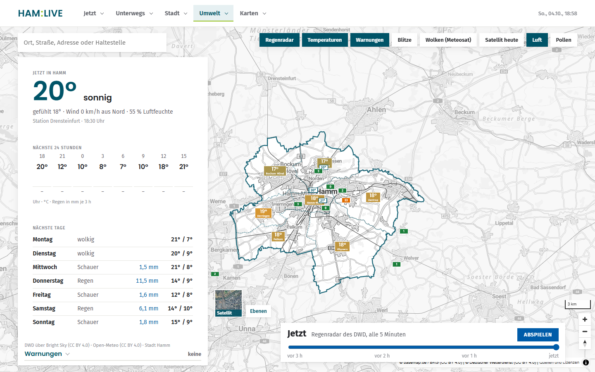
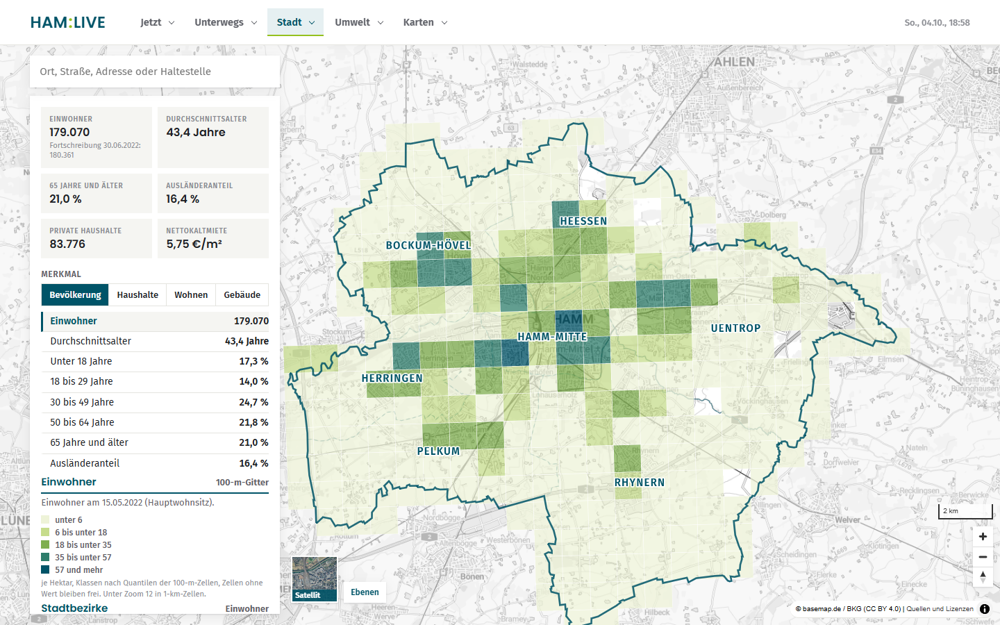
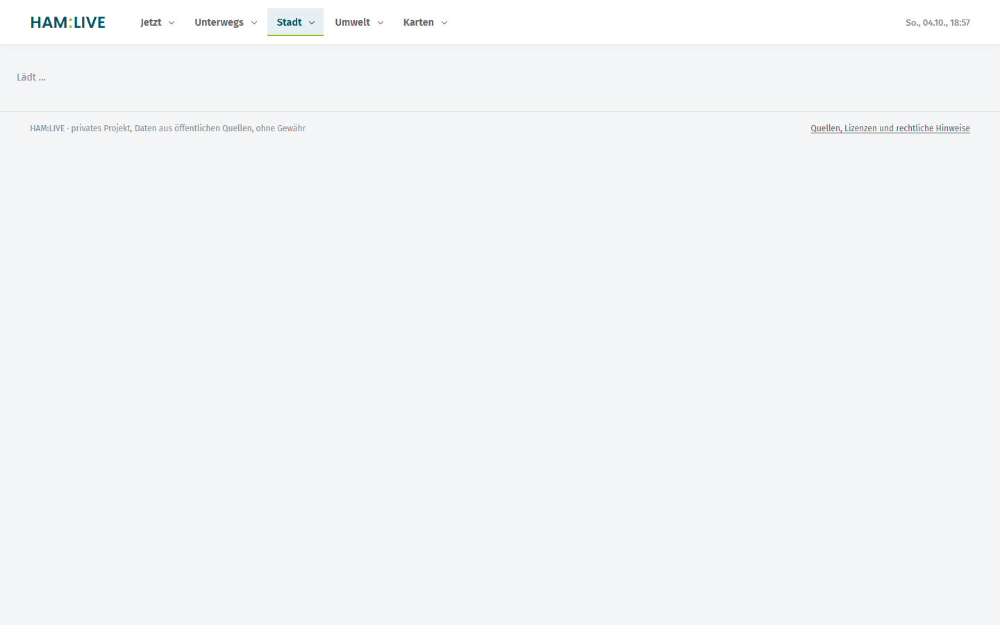
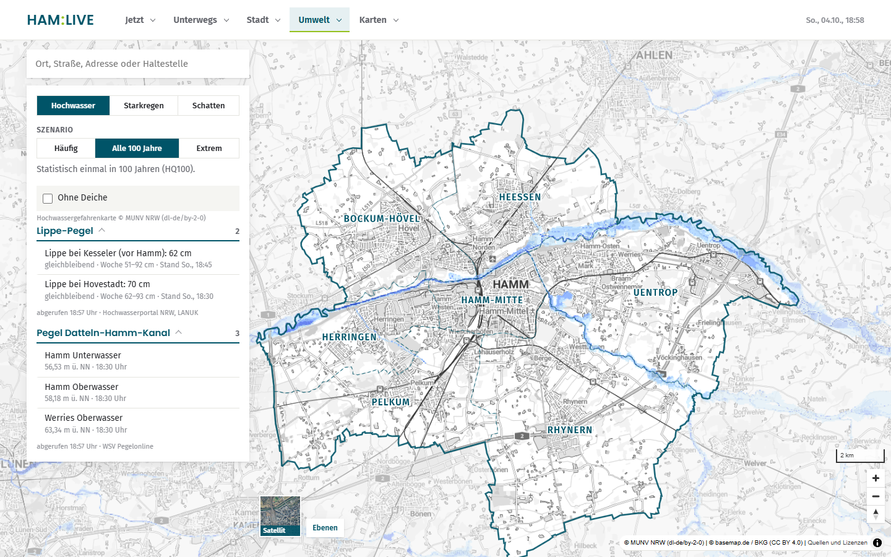

# HAM:LIVE

**Hamm in Echtzeit.** Eine Web-Karte für Hamm (Westfalen), die offene Daten an einer Stelle zusammenführt: Verkehr, Busse und Züge, Baustellen, Spritpreise, Wetter, Pegel, Energie, Bevölkerung, Wahlen und historische Karten.

> **Zum Namen:** HAM ist das Kfz-Kennzeichen von Hamm, LIVE steht für die laufend aktualisierten Daten. Der Doppelpunkt ist ein Gestaltungselement, keine Abkürzung.

Privates, nicht kommerzielles Projekt. Alle Daten gehören den jeweiligen Anbietern; ihre Lizenzen stehen in der Anwendung unter „Quellen und Lizenzen“ und im Code bei jeder Quelle.



## Was die Karte zeigt

| Bereich | Inhalt | Wichtigste Quellen |
|---|---|---|
| Verkehr | Staumeldungen, amtliche Baustellen und Sperrungen, Busse nach Fahrplan, Züge, Autobahn A1/A2, Parken, Ladesäulen | Autobahn GmbH, GTFS Deutschland, Verkehr.NRW, Ladesäulenregister |
| Tanken | Literpreis je Tankstelle auf der Karte, günstigste in Hamm, Verlauf über den Tag | Tankerkönig / Markttransparenzstelle (eigener kostenloser Schlüssel) |
| Wetter | Regenradar mit Wiedergabe, Temperatur je Stadtbezirk, Wetterbericht, Warnungen, Luftqualität | DWD (Bright Sky), Open-Meteo, Stadt Hamm, Umweltbundesamt, Sensor.Community |
| Simulation | Hochwasser der Lippe (HQ häufig / 100 / extrem), Starkregen, Schatten der 3D-Gebäude | Land NRW, BKG, Geobasis NRW |
| Energie | geschätzter Stromverbrauch der Stadt, Eigenerzeugung, Photovoltaik und Wind in Hamm, Strommix | Energy-Charts (Fraunhofer ISE), Marktstammdatenregister, DWD |
| Bevölkerung | Zensus 2022 im 100-Meter-Raster: 36 Merkmale von Alter über Miete bis Heizungsart, Werte je Stadtbezirk | Statistische Ämter des Bundes und der Länder |
| Stadt | Notdienste und Notaufnahmen, Einrichtungen, Wahlergebnisse je Stimmbezirk | OpenStreetMap, Stadt Hamm |
| Karten | Luftbilder und topografische Karten seit 1840 mit Zeitregler, frei kombinierbare Ebenen (Kataster, Lärm, Boden, Solarpotenzial …) | Geobasis NRW, LANUK NRW, basemap.de |

| | |
|---|---|
|  |  |
| Bevölkerung: Zensus 2022 im 100-Meter-Raster | Energie: Schätzung für Hamm mit Methodik |
|  | |
| Simulation: Hochwasser der Lippe (HQ100) | |

Die Oberfläche ist auf Deutsch, funktioniert auf Desktop und Handy und lehnt sich an das Erscheinungsbild der Stadt Hamm an (Petrol und Grün, Fira Sans und Poppins), ohne Stadtlogo oder Wappen.

## Aufbau

| Teil | Ort | Technik |
|---|---|---|
| Oberfläche | `web/src/` | TypeScript, Vite, MapLibre GL, kein Framework |
| Server und Schnittstellen | `web/server/` | Node 24 ohne Abhängigkeiten: Proxy mit Zwischenspeicher, Aufzeichnung alle 5 Minuten, Statistik, Kachelspeicher |
| Datenaufbereitung | `daten/` | Python-Skripte, erzeugen `web/public/daten/` aus offenen Rohdaten |
| Betrieb | `Dockerfile`, `compose.yaml`, `deploy/` | ein Container, Daten als Volumes, Image über GitHub Actions |
| Prüfung | `web/scripts/ui-pruefung.mjs` | Playwright: jede Seite auf Desktop und Handy, Bilder und messbare Fehler |

## Starten

Entwicklung:

```bash
cd web
npm install
npm run dev
```

Container:

```bash
docker compose up -d --build
```

Danach http://localhost:5300. Details in [`docs/betrieb.md`](docs/betrieb.md).

Die Karte braucht erzeugte Daten in `web/public/daten/` (Stadtgrenzen, Fahrplan, Straßen, Zensus …). Die Skripte in `daten/` erzeugen sie aus offenen Rohdaten (OpenStreetMap-Auszug, GTFS Deutschland, Geobasis NRW, Zensus 2022); der Ordner mit den Rohdaten wird über `HAM_ROHDATEN` angegeben.

## Quellen ohne offene Lizenz

Einige Quellen haben keine offene Lizenz, zum Beispiel Nachrichten-Feeds, ein Radio-Livestream, Fahrplan-Echtzeit und die Verkehrslage von Verkehr.NRW. Sie sind im Code mit „nur privat“ gekennzeichnet und **standardmäßig abgeschaltet**: Der Server sperrt diese Hosts, die Oberfläche blendet die Bereiche aus. Wer sie für sich privat nutzen möchte, setzt `HAM_PRIVATQUELLEN=an`. Eine öffentlich erreichbare Installation mit diesen Quellen braucht die Erlaubnis der jeweiligen Anbieter.

Für Spritpreise ist ein eigener, kostenloser Schlüssel von [Tankerkönig](https://creativecommons.tankerkoenig.de/) nötig (`HAM_TANKERKOENIG` oder `local/tankerkoenig.json`).

## Haftung

Keine Gewähr für Richtigkeit, Vollständigkeit oder Aktualität. Schätzungen sind als solche gekennzeichnet; verbindlich sind die Originalquellen. HAM:LIVE ist nicht mit der Stadt Hamm oder den genannten Anbietern verbunden.

## Lizenz

Code: MIT, siehe [`LICENSE`](LICENSE). Daten, Texte, Bilder und Streams der Anbieter fallen nicht darunter.
